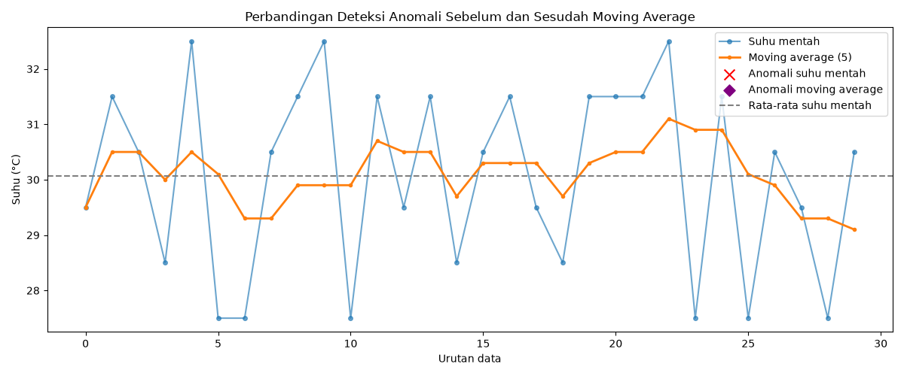
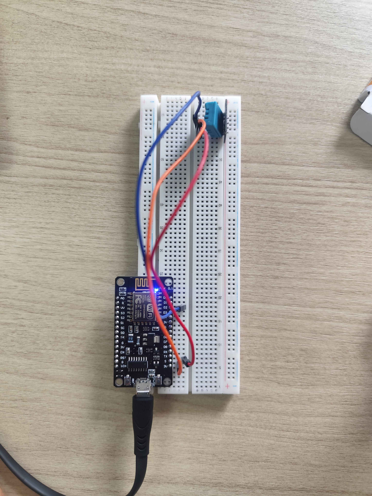
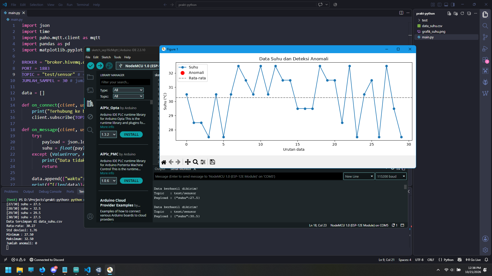

# Modul 5 - Pengolahan dan Analisis Data

> [!IMPORTANT]
> Mengimplementasikan bagaimana cara melakukan filtering pada sisi client processing dan juga server processing dengan menggunakan metode moving average. Data yang didapat kemudian dianalisis menggunakan metode z score untuk mendeteksi anomali atau data yang menyimpang dari pola normal.

## Isi Dari README.md Ini

- [Library (Yang digunakan)](#library)
- [Percobaan (Kode asli, Penjelasannya)](#percobaan-praktikum)
- [Pertanyaan Praktikum (Source Code, Penjelasan)](#pertanyaan-praktikum)
- [Dokumentasi](#dokumentasi)

## Library

Libary yang diperlukan untuk

- pandas(Python): Untuk pengolahan data
- paho-mqtt(Python): Untuk berkomunikasi dengan protokol MQTT
- matplotlib(Python): Untuk membuat visualisasi data

## Percobaan Praktikum

### Percobaan 5A

`File : ./Code/Percobaan5A.cpp`

```cpp
// #include <DHT.h>

// #define DHTPIN 4
// #define DHTTYPE DHT22

// DHT dht(DHTPIN, DHTTYPE);
// Harusnya pakai dht tapi engga di sediain kampus

const int N = 5;                  // jumlah sampel moving average
float buffer[N];                  // menyimpan N pembacaan terakhir
int indeks = 0;                   // posisi penulisan berikutnya pada buffer
int jumlah = 0;                   // jumlah sampel yang sudah terisi

float suhuMin = 1000.0; // Batas normal maksimum suhu
float suhuMax = -1000.0; // Batas normal minimum suhu

// Fungsi menghtiung Moving Average
float hitungMovingAverage(float nilaiBaru) {
  buffer[indeks] = nilaiBaru; // memasukan nilai baru ke buffer
  indeks = (indeks + 1) % N; // mengatur ulang indeks menjadi indeks sebelumnya + 1 yang selanjutnya ambil sisa bagi dengan panjang total data
  if (jumlah < N) jumlah++; // jumlah kurang dari total data maka tambah 1 angka

  float total = 0;
  for (int i = 0; i < jumlah; i++) { // sum dari data saat ini
    total += buffer[i];
  }
  return total / jumlah; // mengembalikan nilai total / jumlah
}

// Mock function pengganti sensor DHT22
float bacaSuhuMock() {
    static unsigned long jumlahBaca = 0;
    jumlahBaca++;

    // Suhu dasar berubah secara bertahap
    float suhuDasar = 28.0 + 2.0 * sin(jumlahBaca * 0.08);

    // Noise kecil untuk mensimulasikan fluktuasi sensor
    float noise = random(-5, 6) * 0.1;

    float suhu = suhuDasar + noise;

    // Lonjakan suhu setiap 25 pembacaan untuk simulasi anomali
    if (jumlahBaca % 25 == 0) {
        suhu += 8.0;
    }

    return suhu;
}

// Fungsi yang akan di panggil sekali saat ESP dinyalakan
void setup() {
  Serial.begin(115200); // Mengatur serial monitor agar berjalan di bautrate 115200
  // dht.begin();
}

void loop() {
  float suhu = bacaSuhuMock(); //dht.readTemperature(); , menggunakan fungsi tersebut untuk menghasilkan data acak pengganti dht

  if (isnan(suhu)) { // Mengecek apakah nilai suhu itu valid dan bukan nan, jika iya maka tampilkan pesan error
    Serial.println("Pembacaan gagal, data diabaikan");
  } else {
    float suhuFilter = hitungMovingAverage(suhu); // memanggil fungsi filtering

    if (suhu < suhuMin) suhuMin = suhu; // mengganti nilai suhu minimum, jika suhu saat ini lebih kecil dari yang tersimpan
    if (suhu > suhuMax) suhuMax = suhu; // mengganti nilai suhu maksimal, jika suhu saat ini lebih besar dari yang tersimpan

    // Menampilkan data
    Serial.print("Mentah: ");
    Serial.print(suhu);
    Serial.print(" | Filter: ");
    Serial.print(suhuFilter);
    Serial.print(" | Min: ");
    Serial.print(suhuMin);
    Serial.print(" | Max: ");
    Serial.println(suhuMax);
  }

  delay(2000); // Jeda 2 detik
}
```

### Percobaan 5A

`File : ./Code/Percobaan5B.py`

```py
import json
import time
import paho.mqtt.client as mqtt
import pandas as pd
import matplotlib.pyplot as plt

BROKER = "broker.hivemq.com" # domain brocker
PORT = 1883 # port broker
TOPIC = "test/sensor" # = topicData ESP32
JUMLAH_SAMPEL = 30 # jumlah data

data = [] # variabel penampung data

# fungsi yang akan dijalankan saat terhubung ke mqtt
def on_connect(client, userdata, flags, reason_code, properties):
    print("Terhubung ke broker, kode:", reason_code)
    client.subscribe(TOPIC) # melakukan subscribe ke topik yang ditentukan

# fungsi yang akan selalu dipanggil saat client menerima pesan
def on_message(client, userdata, msg):
    try:
        payload = json.loads(msg.payload.decode()) # melakukan decode dari string ke json yang diterima client
        suhu = float(payload["suhu"]) # nilai suhu dari mqtt
    except (ValueError, KeyError): # jika terjadi error, maka tampilkan pesan error dan menunggu pesan selanjutnya
        print("Data tidak valid, diabaikan")
        return

    # memasukan data ke variabel data bersamaan dengan waktu menerima data tersebut, lalu tampilkan
    data.append({"waktu": time.strftime("%Y-%m-%d %H:%M:%S"), "suhu": suhu})
    print(f"[{len(data)}/{JUMLAH_SAMPEL}] suhu = {suhu}")

    if len(data) >= JUMLAH_SAMPEL: # jika data sudah mencapai 30, maka mematikan koneksi client
        client.disconnect()

# -- Tahap 1: akuisisi data dari MQTT
# setup mqtt
client = mqtt.Client(mqtt.CallbackAPIVersion.VERSION2) # membuat client
client.on_connect = on_connect # mengatur fungsi saat berhasil terkoneksi
client.on_message = on_message # mengatur fungsi saat ada pesan masuk
client.connect(BROKER, PORT) # memulai koneksi ke mqtt
client.loop_forever() # menjaga koneksi dan juga menerima pesan masuk

# -- Tahap 2: simpan ke CSV
df = pd.DataFrame(data) # membuat objek panda
df.to_csv("data_suhu.csv", index=False) # menyimpan data menjadi csv
print("Data tersimpan di data_suhu.csv")

# -- Tahap 3: analisis statistik dan deteksi anomali (z-score)
rata2 = df["suhu"].mean() # nilai rata-rata
std = df["suhu"].std() # nilai simpangan baku

# menentukan z score
if std == 0:
    df["zscore"] = 0.0
else:
    df["zscore"] = (df["suhu"] - rata2) / std

df["anomali"] = df["zscore"].abs() > 2 # nilai anomali, dimana jika nilai z score absolute lebih besar dari 2 maka di anggap anomali

# menampilkan hasil rekap
print(f"Rata-rata: {rata2:.2f}")
print(f"Std deviasi: {std:.2f}")
print(f"Minimum : {df['suhu'].min():.2f}")
print(f"Maksimum: {df['suhu'].max():.2f}")
print(f"Jumlah anomali: {df['anomali'].sum()}")

# -- Tahap 4: visualisasi
plt.figure(figsize=(10,4))  # Membuat kanvas grafik berukuran 10 × 4 inci.
plt.plot(df.index, df["suhu"], marker="o", label="Suhu")  # Menggambar suhu berdasarkan urutan data dengan penanda titik.
anom = df[df["anomali"]]  # Memilih baris data yang terdeteksi sebagai anomali.
plt.scatter(anom.index, anom["suhu"], color="red", s=100, label="Anomali", zorder=3)  # Menandai anomali dengan titik merah.
plt.axhline(rata2, color="gray", linestyle="--", label="Rata-rata")  # Menambahkan garis putus-putus pada nilai rata-rata.
plt.xlabel("Urutan data")  # Memberi label pada sumbu horizontal.
plt.ylabel("Suhu (°C)")  # Memberi label pada sumbu vertikal.
plt.title("Data Suhu dan Deteksi Anomali")  # Memberi judul grafik.
plt.legend()  # Menampilkan keterangan untuk setiap garis dan penanda.
plt.tight_layout()  # Merapikan jarak elemen agar tidak saling bertumpuk.
plt.savefig("grafik_suhu.png") # simpan gambar
plt.show() # tampilkan dalam bentuk window
```

## Pertanyaan Praktikum

### Percobaan 5A - Modifikasi program agar ESP32 juga menghitung simpangan baku dari data pada buffer, dan berikan penjelasan di setiap baris kode yang ditambahkan dalam bentuk README.md

`File : ./Code/Percobaan5A-Answer.cpp`

```cpp
#include <math.h>

// #include <DHT.h>

// #define DHTPIN 4
// #define DHTTYPE DHT22

// DHT dht(DHTPIN, DHTTYPE);

const int N = 5; // Jumlah sampel moving average
float buffer[N]; // Menyimpan N pembacaan terakhir
int indeks = 0;  // Posisi penulisan berikutnya pada buffer
int jumlah = 0;  // Jumlah sampel yang sudah terisi

float suhuMin = 1000.0;
float suhuMax = -1000.0;

float hitungMovingAverage(float nilaiBaru) {
    buffer[indeks] = nilaiBaru;
    indeks = (indeks + 1) % N;

    if (jumlah < N) jumlah++;

    float total = 0;

    for (int i = 0; i < jumlah; i++) {
        total += buffer[i];
    }

    return total / jumlah;
}

float hitungSimpanganBaku() {
    if (jumlah == 0) return 0.0;

    float total = 0.0;

    for (int i = 0; i < jumlah; i++) {
        total += buffer[i];
    }

    float rataRata = total / jumlah;
    float totalKuadratSelisih = 0.0;

    for (int i = 0; i < jumlah; i++) {
        float selisih = buffer[i] - rataRata;

        totalKuadratSelisih += selisih * selisih;
    }

    float varians = totalKuadratSelisih / jumlah;

    return sqrtf(varians);
}

float bacaSuhuMock() {
    static unsigned long jumlahBaca = 0;
    jumlahBaca++;

    float suhuDasar = 28.0 + 2.0 * sin(jumlahBaca * 0.08);

    float noise = random(-5, 6) * 0.1;
    float suhu = suhuDasar + noise;

    if (jumlahBaca % 25 == 0) {
        suhu += 8.0;
    }

    return suhu;
}

void setup() {
    Serial.begin(115200);
    // dht.begin();
}

void loop() {
    float suhu = bacaSuhuMock(); // dht.readTemperature();

    if (isnan(suhu)) {
        Serial.println("Pembacaan gagal, data diabaikan");
    } else {
        float suhuFilter = hitungMovingAverage(suhu);

        float simpanganBaku = hitungSimpanganBaku();

        if (suhu < suhuMin) suhuMin = suhu;
        if (suhu > suhuMax) suhuMax = suhu;

        Serial.print("Mentah: ");
        Serial.print(suhu);
        Serial.print(" | Filter: ");
        Serial.print(suhuFilter);
        Serial.print(" | Simpangan Baku: ");
        Serial.print(simpanganBaku, 3);
        Serial.print(" | Min: ");
        Serial.print(suhuMin);
        Serial.print(" | Max: ");
        Serial.println(suhuMax);
    }

    delay(2000);
}
```

**Penjelasan**

1. Menambahkan pustaka matematika

```cpp
#include <math.h>
```

2. Membuat fungsi hitungSimpanganBaku()

```cpp
float hitungSimpanganBaku() {
    //  Menghentikan perhitungan jika belum ada sampel.
    if (jumlah == 0) return 0.0;

    //  Variabel untuk menampung total seluruh data buffer.
    float total = 0.0;

    //  Menjumlahkan semua sampel yang sudah tersimpan.
    for (int i = 0; i < jumlah; i++) {
        total += buffer[i];
    }

    //  Menghitung rata-rata sampel yang ada di buffer.
    float rataRata = total / jumlah;

    //  Variabel untuk menampung jumlah kuadrat selisih.
    float totalKuadratSelisih = 0.0;

    //  Menghitung selisih setiap sampel terhadap rata-rata.
    for (int i = 0; i < jumlah; i++) {
        float selisih = buffer[i] - rataRata;

        //  Mengkuadratkan selisih agar nilai negatif
        // tidak saling menghilangkan dengan nilai positif.
        totalKuadratSelisih += selisih * selisih;
    }

    // Menghitung varians populasi dengan membagi jumlah
    //  kuadrat selisih dengan jumlah sampel.
    float varians = totalKuadratSelisih / jumlah;

    // Mengembalikan akar kuadrat varians sebagai simpangan baku.
    return sqrtf(varians);
}
```

3. Memanggil fungsi pada loop()

```cpp
float simpanganBaku = hitungSimpanganBaku();
```

4. Menampilkan hasil pada Serial Monitor

```cpp
Serial.print(" | Simpangan Baku: ");
Serial.print(simpanganBaku, 3);
```

### Percobaan 5B - Modifikasi program agar menggunakan metode moving average (jendela 5 data) pada data hasil CSV sebelum dihitung z-score-nya, kemudian bandingkan jumlah anomali yang terdeteksi, dan berikan penjelasan di setiap baris kode yang ditambahkan dalam bentuk README.md

`File : ./Code/Percobaan5B-Answer.py`

```py
import json
import time
import paho.mqtt.client as mqtt
import pandas as pd
import matplotlib.pyplot as plt

BROKER = "broker.hivemq.com"
PORT = 1883
TOPIC = "test/sensor"
JUMLAH_SAMPEL = 30

WINDOW_SIZE = 5

data = []

def on_connect(client, userdata, flags, reason_code, properties):
    print("Terhubung ke broker, kode:", reason_code)
    client.subscribe(TOPIC)

def on_message(client, userdata, msg):
    try:
        payload = json.loads(msg.payload.decode())
        suhu = float(payload["suhu"])
    except (ValueError, KeyError):
        print("Data tidak valid, diabaikan")
        return

    data.append({
        "waktu": time.strftime("%Y-%m-%d %H:%M:%S"),
        "suhu": suhu
    })
    print(f"[{len(data)}/{JUMLAH_SAMPEL}] suhu = {suhu}")

    if len(data) >= JUMLAH_SAMPEL:
        client.disconnect()

# -- Tahap 1: akuisisi data dari MQTT
client = mqtt.Client(mqtt.CallbackAPIVersion.VERSION2)
client.on_connect = on_connect
client.on_message = on_message
client.connect(BROKER, PORT)
client.loop_forever()

# -- Tahap 2: simpan ke CSV
df = pd.DataFrame(data)
df.to_csv("data_suhu.csv", index=False)
print("Data tersimpan di data_suhu.csv")

df = pd.read_csv("data_suhu.csv")

df["suhu_ma"] = df["suhu"].rolling(
    window=WINDOW_SIZE,
    min_periods=1
).mean()

# -- Tahap 3: deteksi anomali menggunakan z-score

rata2 = df["suhu"].mean()
std = df["suhu"].std()

if std == 0:
    df["zscore_mentah"] = 0.0
else:
    df["zscore_mentah"] = (df["suhu"] - rata2) / std

df["anomali_mentah"] = df["zscore_mentah"].abs() > 2

rata2_ma = df["suhu_ma"].mean()

std_ma = df["suhu_ma"].std()

if pd.isna(std_ma) or std_ma == 0:
    df["zscore_ma"] = 0.0
else:
    df["zscore_ma"] = (df["suhu_ma"] - rata2_ma) / std_ma

df["anomali_ma"] = df["zscore_ma"].abs() > 2

jumlah_anomali_mentah = int(df["anomali_mentah"].sum())
jumlah_anomali_ma = int(df["anomali_ma"].sum())

selisih_anomali = jumlah_anomali_mentah - jumlah_anomali_ma

df.to_csv("hasil_analisis_suhu.csv", index=False)

print("\n=== Statistik suhu mentah ===")
print(f"Rata-rata       : {rata2:.2f}")
print(f"Std deviasi     : {std:.2f}")
print(f"Minimum         : {df['suhu'].min():.2f}")
print(f"Maksimum        : {df['suhu'].max():.2f}")
print(f"Jumlah anomali  : {jumlah_anomali_mentah}")

print("\n=== Statistik suhu moving average ===")
print(f"Rata-rata       : {rata2_ma:.2f}")
print(f"Std deviasi     : {std_ma:.2f}")
print(f"Jumlah anomali  : {jumlah_anomali_ma}")

print("\n=== Perbandingan deteksi anomali ===")
print(f"Anomali suhu mentah      : {jumlah_anomali_mentah}")
print(f"Anomali setelah MA (5)   : {jumlah_anomali_ma}")

if selisih_anomali > 0:
    print(f"Anomali berkurang        : {selisih_anomali}")
elif selisih_anomali < 0:
    print(f"Anomali bertambah        : {abs(selisih_anomali)}")
else:
    print("Jumlah anomali sama pada kedua metode.")

print("Hasil lengkap tersimpan di hasil_analisis_suhu.csv")

# -- Tahap 4: visualisasi

plt.figure(figsize=(12, 5))

plt.plot(
    df.index, df["suhu"],
    marker="o", markersize=4,
    label="Suhu mentah", alpha=0.65
)
plt.plot(
    df.index, df["suhu_ma"],
    marker=".", linewidth=2,
    label="Moving average (5)"
)

anom_mentah = df[df["anomali_mentah"]]
plt.scatter(
    anom_mentah.index, anom_mentah["suhu"],
    color="red", marker="x", s=100,
    label="Anomali suhu mentah", zorder=3
)

anom_ma = df[df["anomali_ma"]]
plt.scatter(
    anom_ma.index, anom_ma["suhu_ma"],
    color="purple", marker="D", s=60,
    label="Anomali moving average", zorder=4
)

plt.axhline(
    rata2, color="gray", linestyle="--",
    label="Rata-rata suhu mentah"
)

plt.xlabel("Urutan data")
plt.ylabel("Suhu (°C)")
plt.title("Perbandingan Deteksi Anomali Sebelum dan Sesudah Moving Average")
plt.legend()
plt.tight_layout()
plt.savefig("grafik_suhu.png")
plt.show()
```

**Output**



**Penjelasan**

1. Menentukan ukuran jendela

```py
WINDOW_SIZE = 5
```

2. Membaca data CSV

```py
df = pd.read_csv("data_suhu.csv")
```

3. Menghitung moving average

```py
df["suhu_ma"] = df["suhu"].rolling(
    window=WINDOW_SIZE,
    min_periods=1
).mean()
```

4. Menghitung rata-rata hasil moving average

```py
rata2_ma = df["suhu_ma"].mean()
```

5. Menghitung simpangan baku hasil moving average

```py
std_ma = df["suhu_ma"].std()
```

6. Menghitung z-score moving average

```py
if pd.isna(std_ma) or std_ma == 0:
    df["zscore_ma"] = 0.0
else:
    df["zscore_ma"] = (df["suhu_ma"] - rata2_ma) / std_ma
```

7. Menentukan anomali moving average

```py
df["anomali_ma"] = df["zscore_ma"].abs() > 2
```

8. Menghitung jumlah anomali

```py
jumlah_anomali_mentah = int(df["anomali_mentah"].sum())
jumlah_anomali_ma = int(df["anomali_ma"].sum())
```

9. Menghitung selisih jumlah anomali

```py
selisih_anomali = jumlah_anomali_mentah - jumlah_anomali_ma
```

10. Menyimpan hasil analisis

```py
df.to_csv("hasil_analisis_suhu.csv", index=False)
```

11. Menampilkan statistik moving average

```py
print(f"Rata-rata       : {rata2_ma:.2f}")
print(f"Std deviasi     : {std_ma:.2f}")
print(f"Jumlah anomali  : {jumlah_anomali_ma}")
```

12. Menampilkan perbandingan

```py
print(f"Anomali suhu mentah      : {jumlah_anomali_mentah}")
print(f"Anomali setelah MA (5)   : {jumlah_anomali_ma}")
```

13. Menandai anomali suhu mentah pada grafik

```py
anom_mentah = df[df["anomali_mentah"]]
plt.scatter(
    anom_mentah.index, anom_mentah["suhu"],
    color="red", marker="x", s=100,
    label="Anomali suhu mentah", zorder=3
)
```

14. Menandai anomali moving average

```py
anom_ma = df[df["anomali_ma"]]
plt.scatter(
    anom_ma.index, anom_ma["suhu_ma"],
    color="purple", marker="D", s=60,
    label="Anomali moving average", zorder=4
)
```

## Dokumentasi

### Percobaan 5A



### Percobaan 5B


